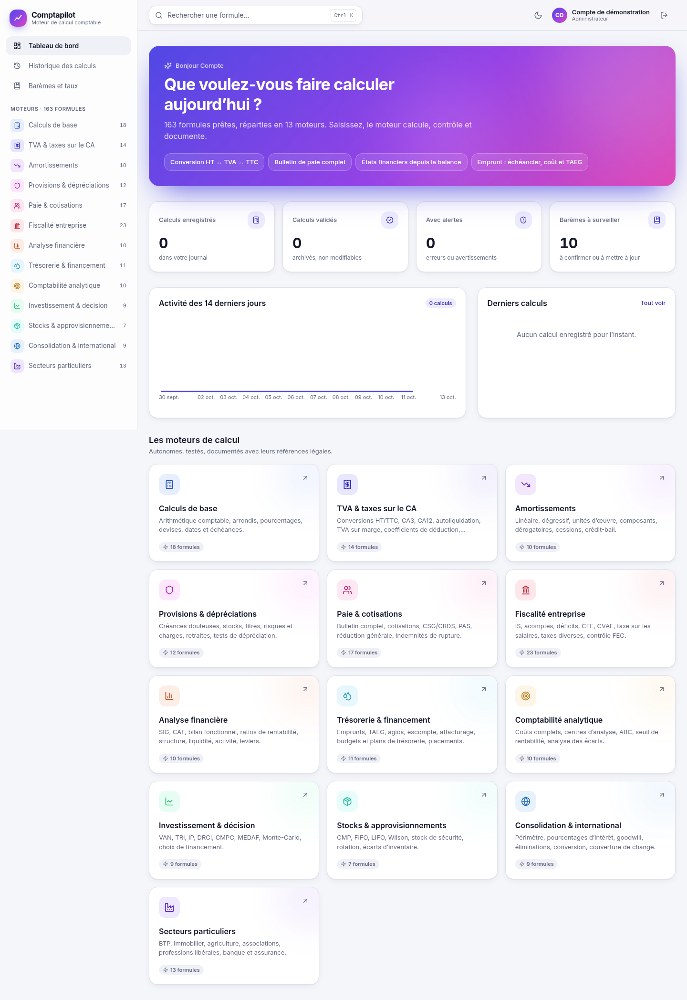

# Comptapilot

*Édité par **Vision Technologie**.*

Application web de calcul comptable, fiscal et social. **Le comptable ne calcule plus : il vérifie et il valide.**

Chaque saisie déclenche le calcul complet par un moteur déterministe. Le résultat affiche sa formule, ses étapes chiffrées, ses contrôles de cohérence, ses écritures comptables, ses références légales et la version des barèmes appliquée à la date de l'opération. Un calcul validé est archivé avec son empreinte SHA-256 et ne peut plus être supprimé.



## En bref

| | |
|---|---|
| **163 formules** dans **13 moteurs** | base, TVA, amortissements, provisions, paie, fiscalité, analyse financière, trésorerie, analytique, investissement, stocks, consolidation, secteurs particuliers |
| **Précision** | `decimal.js` à 28 chiffres significatifs, arrondi commercial ; aucun nombre flottant dans les calculs |
| **16 barèmes versionnés** | appliqués selon la date de l'opération, avec alerte si une version est à confirmer ou si le barème n'est pas à jour |
| **548 tests** | chaque exemple documenté est rejoué, plus tests de propriétés (fast-check) et balayage de toutes les options |
| **Performance** | médiane 0,23 ms par calcul, aucun cas au-delà de 100 ms ([benchmarks](docs/BENCHMARKS.md)) |

## Démarrage avec Docker

```bash
cp .env.example .env        # renseigner POSTGRES_PASSWORD et JWT_SECRET (openssl rand -base64 48)
docker compose up -d --build
```

L'application est servie sur **http://localhost:8090** (variable `COMPTA_PORT`). Le premier compte créé devient administrateur.

Trois conteneurs : `postgres` (volume `donnees`), `backend` (API, migrations appliquées au démarrage) et `frontend` (nginx, qui relaie `/api` vers le backend). Seul le frontend est publié sur l'hôte.

## Développement

Prérequis : Node.js 20 et une base PostgreSQL 16.

```bash
npm install
npm run build:moteurs                        # le backend consomme moteurs/dist

# Base de développement (exemple avec Docker, port 5433)
docker run -d --name compta-postgres-dev -p 5433:5432 \
  -e POSTGRES_USER=compta -e POSTGRES_PASSWORD=compta -e POSTGRES_DB=compta postgres:16-alpine

cp backend/.env.example backend/.env         # ajuster DATABASE_URL et JWT_SECRET
npm run db:deploy -w backend

npm run dev -w backend                       # API sur http://localhost:4100
npm run dev -w frontend                      # interface sur http://localhost:5174
```

| Commande (racine) | Effet |
|---|---|
| `npm test` | tests du moteur (Jest) |
| `npm test -w backend` | tests de l'API (base `compta_test`, à créer) |
| `npm run test:coverage -w moteurs` | couverture du moteur |
| `npm run docs` | régénère [docs/FORMULES.md](docs/FORMULES.md) et [docs/BAREMES.md](docs/BAREMES.md) |
| `npm run bench` | régénère [docs/BENCHMARKS.md](docs/BENCHMARKS.md) |
| `npm run captures` | captures d'écran dans [docs/screenshots](docs/screenshots) (API et Vite démarrés, Chrome requis) |
| `npm run parcours` | parcours complet en navigateur : inscription, codes, mot de passe oublié, connexion par téléphone (mode démonstration) |

## Organisation du dépôt

```
moteurs/    @compta/moteurs — bibliothèque TypeScript pure, sans dépendance au web ni à la base
  src/noyau/          décimaux, dates, barèmes, contexte de calcul, registre, finance, statistiques
  src/calculs-*/      un dossier par moteur
  tests/              exemples, noyau, propriétés, variantes
  scripts/            génération de la documentation et benchmarks
backend/    @compta/backend — API REST Express 5, Prisma, PostgreSQL
frontend/   @compta/frontend — React 18, Vite, Tailwind, TanStack Query
docs/       FORMULES.md, BAREMES.md, BENCHMARKS.md, ARCHITECTURE.md, ROADMAP.md, captures
scripts/    captures d'écran (Playwright)
```

L'architecture détaillée (cycle d'un calcul, contexte, barèmes, API, modèle de données, ajout d'une formule) est décrite dans **[docs/ARCHITECTURE.md](docs/ARCHITECTURE.md)**.

## Comptes : inscription, confirmation, mot de passe oublié

- **Inscription en trois étapes** : identité (nom, e-mail, téléphone mobile avec indicatif), sécurité (mot de passe vérifié en direct), puis **confirmation par deux codes à 6 chiffres** : l'un envoyé par e-mail, l'autre par **SMS ou WhatsApp**, au choix. Le compte n'est utilisable qu'une fois les deux confirmés.
- **Connexion** avec l'adresse e-mail ou le numéro de téléphone.
- **Mot de passe oublié** : code reçu par e-mail, SMS ou WhatsApp, puis nouveau mot de passe. La réponse est identique qu'un compte existe ou non.
- Codes valables 10 minutes, 5 essais au plus, 60 s entre deux envois et 5 envois par heure ; seule leur empreinte HMAC est conservée.

### Configurer l'envoi des codes

| Canal | Fournisseur | Variables (`.env`) |
|---|---|---|
| E-mail | tout serveur SMTP (Brevo, Gmail avec mot de passe d'application, OVH, Mailjet…) | `SMTP_HOST`, `SMTP_PORT`, `SMTP_SECURE`, `SMTP_USER`, `SMTP_PASS`, `EMAIL_EXPEDITEUR` |
| SMS | Twilio | `TWILIO_ACCOUNT_SID`, `TWILIO_AUTH_TOKEN`, `TWILIO_SMS_FROM` |
| WhatsApp | Twilio (bac à sable pour les essais, numéro WhatsApp Business validé en production) | `TWILIO_ACCOUNT_SID`, `TWILIO_AUTH_TOKEN`, `TWILIO_WHATSAPP_FROM` |

Sans fournisseur, **`CODES_VISIBLES=true`** active le **mode démonstration** : rien n'est envoyé, le code de confirmation d'inscription s'affiche à l'écran dans un encadré signalé « Mode démonstration ». Le code de **mot de passe oublié n'est jamais affiché** (sinon n'importe qui pourrait prendre un compte existant) : il est écrit dans le journal du serveur (`docker compose logs backend`), où l'administrateur peut le lire. À réserver aux essais : en production, laisser `false` et configurer les fournisseurs.

Un changement de mot de passe ferme toutes les sessions ouvertes du compte.

## Langue et monnaie

Chaque utilisateur choisit, depuis le menu **Langue et monnaie** de l'en-tête (ou à l'inscription) :

- la **langue de l'interface** : français ou anglais. Le contenu des formules (noms, explications, étapes, références légales) reste en français : il décrit le droit français ;
- la **monnaie d'affichage**, parmi 18 : franc CFA (XOF, XAF), euro, dollar, livre, franc suisse, dirham, naira, cedi, rand, yen… **Aucune conversion** n'est appliquée : la monnaie indique l'unité dans laquelle on saisit et lit les montants. Les calculs restent au centime ; l'affichage est arrondi selon la monnaie (sans décimale pour le franc CFA).

Les préférences sont enregistrées sur le compte. Chaque calcul archivé conserve sa monnaie de saisie. Une formule qui applique des barèmes légaux français en euros (paie, fiscalité…) l'indique quand une autre monnaie est choisie.

## API

Toutes les routes sauf `/api/auth/*` et `/api/sante` exigent une session (cookie `compta_session` ou en-tête `Authorization: Bearer`).

```http
POST /api/calc/tva/ht-ttc
Content-Type: application/json

{ "entrees": { "connu": "ht", "montant": "1000", "taux": "20" }, "enregistrer": false, "devise": "EUR" }
```

```jsonc
{
  "resultat": {
    "formule": { "id": "ht-ttc", "moteur": "tva", "version": "1.0.0", "expression": "TVA = HT × t ; TTC = HT + TVA ; …" },
    "resultats": {
      "tva": { "libelle": "TVA", "valeur": "200.00", "unite": "EUR", "principal": true },
      "ttc": { "libelle": "Montant TTC", "valeur": "1200.00", "unite": "EUR", "principal": true }
    },
    "etapes": [ … ], "controles": [ … ], "tableaux": [ … ], "ecritures": [ … ],
    "references": [ { "texte": "CGI art. 278 à 281 nonies — taux de TVA" } ],
    "baremes": [ … ], "dureeMs": 0.4
  },
  "empreinte": "c02de51a…"
}
```

Les montants circulent en chaînes décimales, jamais en nombres JSON. Une entrée invalide renvoie `422` avec le détail par champ.

| Route | Rôle |
|---|---|
| `GET /api/calc/catalogue` | moteurs, formules, champs, exemples |
| `GET /api/calc/{moteur}/{formule}` | description d'une formule |
| `POST /api/calc/{moteur}/{formule}` | exécution ; `enregistrer` et `valider` archivent le calcul |
| `GET /api/historique` | journal de l'utilisateur, filtrable (`moteur`, `statut`, `q`) et paginé |
| `GET /api/historique/statistiques` | compteurs et activité sur 14 jours |
| `GET · PATCH · DELETE /api/historique/{id}` | détail, validation, libellé, suppression (refusée si validé) |
| `POST /api/auth/inscription` | création du compte et envoi des deux codes |
| `POST /api/auth/verification/verifier` · `/renvoyer` | saisie d'un code, nouvel envoi (éventuellement par l'autre canal) |
| `POST /api/auth/connexion` | par e-mail ou téléphone (`identifiant`) |
| `POST /api/auth/mot-de-passe/oubli` · `/reinitialiser` | code de réinitialisation, nouveau mot de passe |
| `PATCH /api/auth/preferences` | langue (`fr`, `en`) et monnaie (code ISO 4217) de l'utilisateur |
| `GET /api/baremes` | barèmes, versions, version en vigueur, obsolescence |
| `POST /api/baremes/{code}/versions` | nouvelle version (administrateur) |

## Ce qu'il faut savoir avant usage réel

- **Barèmes à confirmer.** Huit barèmes ont au moins une version marquée « à vérifier » : `paie.constantes`, `paie.cotisations`, `paie.pas-metropole`, `paie.avantages-nature`, `paie.ijss`, `fiscal.cvae`, `fiscal.taxe-salaires`, `sectoriels.micro`. Il s'agit surtout des valeurs 2025-2026 (PASS, SMIC, réduction générale dégressive unique, grilles du PAS…). Tout calcul qui les utilise affiche un avertissement. Un administrateur les confirme ou les corrige depuis l'écran *Barèmes et taux* ; la saisie est historisée et prime sur la bibliothèque.
- **Couverture de tests.** Le moteur est couvert à 94,8 % des lignes et 74,2 % des branches. L'objectif de 100 % sur les formules critiques n'est pas encore atteint ; les branches manquantes sont surtout des messages d'erreur sur entrées incohérentes. Des seuils empêchent toute régression.
- **Responsabilité.** Les résultats sont recoupés par des exemples vérifiés et des contrôles automatiques, mais ils ne remplacent pas la validation d'un professionnel ; c'est précisément le rôle du bouton « Vérifier et valider ».

La suite du projet est décrite dans [docs/ROADMAP.md](docs/ROADMAP.md).
